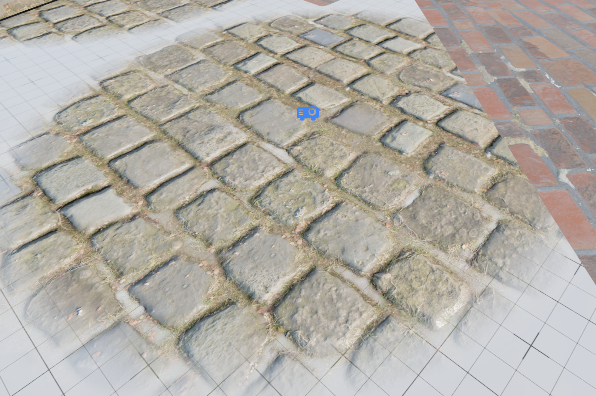

# Decals

A decal projects an image onto the surface it covers, so you can add detail without making unique textures and unwrapping the mesh again.

## Opacity — how much of the surface shows through

At **1** the decal covers the surface completely. You see the decal's own material and nothing of what was underneath.

Below 1, the surface underneath shows through and the decal's material mixes with it. This is what makes dirt, moss, wear, stains and damp patches read as sitting *on* the ground rather than replacing it.

## Height Offset — how high the decal sits

Think of a decal as a surface of its own, laid on top of everything else. **Height Offset** raises that surface up or pushes it down.

Wherever two surfaces meet you see the **higher** one, and the lower one is hidden underneath it. That is true of two decals that overlap, and just as true of a decal and the ground it sits on.

- **Raise it** and the decal sits above what is there, so you see the decal.
- **Lower it** and the decal sinks below, so what was already there stays visible and the decal disappears wherever it is covered.
- Push it far enough down and the decal is under everything, as though it were not there at all.

A decal's own height map works the same way. The raised parts of its texture sit higher than the flat parts, which is what gives the decal relief against the surface it covers. Height Offset moves all of that up or down together, shifting the whole decal without changing its shape.

Where two decals end up at nearly the same height, neither is clearly above the other, so you get a narrow soft seam between them instead of a hard edge.

## What you want, and what to set

| You want                            | Opacity       | Height Offset | What you see                                                       |
| ----------------------------------- | ------------- | ------------- | ------------------------------------------------------------------ |
| A patch of different material       | 1             | 0             | The patch replaces the ground                                      |
| A patch that covers everything      | 1             | a little up   | The patch sits above the ground and above other decals             |
| Dirt or grime on the ground         | below 1       | a little up   | The ground reads through the dirt, and the dirt stays on top of it |
| A subtle stain or wear              | low, e.g. 0.3 | a little up   | Mostly the ground, with a hint of the decal                        |
| Something that stays out of the way | 1             | a little down | It sinks under anything above it                                   |
| Hidden completely                   | any           | well down     | It is below everything, and you do not see it                      |

**Keep Height Offset small.** The band where one surface takes over from the other is narrow, so a little above or below zero already settles it. Changing it from -1 to -0.5 usually changes nothing, because both are already far enough down that the decal is well under everything. Tune it in small steps around zero.

## Shaped decals

The rounded box and circle shapes fade the decal out towards its edges, so it blends into what is underneath instead of stopping abruptly. With Opacity at 1 that edge is what makes a shaped patch sit naturally on a floor.

## Omnidirectional decals

A regular decal points one way, like a sticker. Left flat it covers the floor; to cover a wall you turn it so it faces the wall.

**Omnidirectional** does that turning for you. It works similar to “Cube projection” unwrap and covers the floor, walls and the ceiling within a box.

- It still only covers what it touches, so make it big enough to reach.
- A decal that spans a sharp corner can flip partway across and leave a seam. One decal per surface looks better.
- It does not fade out at an angle. A normal decal fades when you see it almost edge on, because that draws as thin streaks; one that faces the surface is never seen that way.

## If it doesn't look right

| What you see                         | What is happening                                       | What to change                        |
| ------------------------------------ | ------------------------------------------------------- | ------------------------------------- |
| Changing Height Offset does nothing  | Both values are already past the point where it settles | Tune in small steps around 0          |
| A decal disappears under another one | It is sitting lower than the other decal                | Raise it                              |
| Two decals blend into each other     | They are at nearly the same height                      | Move their Height Offset values apart |
| A decal hides everything under it    | Opacity is at 1                                         | Lower it so the surface reads through |

## Mesh decals

Mesh decals are an additional type of decal that are part of the specific mesh and only affect that mesh. They are authored in the mesh editor.

**What they are for:** decals on skinned, animated or otherwise deforming geometry. A mesh decal is baked into its mesh, so it conforms to the UV unwrap exactly and does not swim when the geometry underneath it moves.

**Cost and tradeoffs:**

- On flat surfaces they are cheaper than normal decals — prefer them there.
- On curved surfaces they use extra memory — not a deal breaker, but worth keeping in mind.
- They are stored per triangle, so don’t use them them on highly tessellated geometry.

**Where they pay off:**

- Detailing low-poly flat surfaces — use as many as you like.
- Character customization — scars, tattoos, makeup, etc. The cost is reasonable for what they add.
